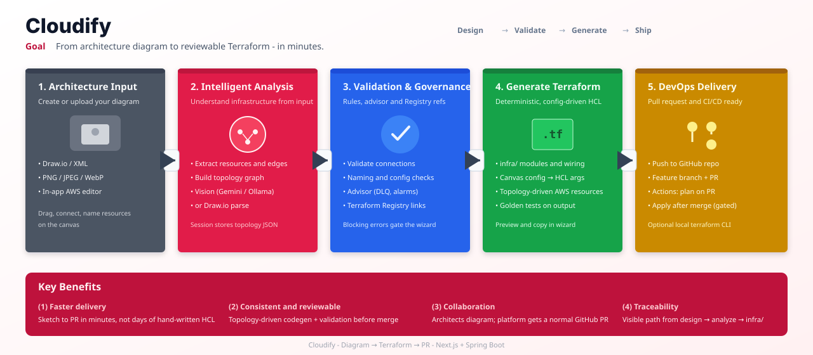

# Cloudify

**Next.js** diagram UI + **Spring Boot** API: model **any AWS topology** on the canvas (SNS, SQS, Lambda, S3, API Gateway, ALB, RDS, DynamoDB, Cognito, CloudFront, and more), validate connections and config, generate `infra/*.tf` from the graph, and open a **GitHub pull request** when configured. **GitHub Actions** runs plan on the PR and apply after merge.

## Demo video

**[Watch on YouTube](https://youtu.be/stuAn5JbQHo)** — architecture editor → analyze → Terraform preview → GitHub delivery walkthrough.

## Workflow overview

<p align="center">
  
</p>

*Pitch-style pipeline (SVG). Export as PNG: open the file in a browser → Save, or use `rsvg-convert` / Figma.*

## Deploy (public demo — canvas + mock PR)

See **[docs/DEPLOY.md](docs/DEPLOY.md)** — Vercel (`apps/web`) + Render API, ~10 minutes, no GitHub secrets.

## Run

```bash
# API
cd apps/api && mvn spring-boot:run

# Web
cd apps/web && npm run dev

# API tests (validation, analyze, golden Terraform codegen)
cd apps/api && mvn test
```

## GitHub PR (personal / infra target repo)

1. Create a GitHub repo (e.g. `your-user/cloudify-infra`) with an empty or minimal `main` branch.
2. Optional: copy [`templates/github-actions/terraform-aws.yml`](templates/github-actions/terraform-aws.yml) manually — Cloudify **adds this workflow on the PR branch** when `GITHUB_ENABLED=true`.
3. Add repository secrets: `AWS_ACCESS_KEY_ID`, `AWS_SECRET_ACCESS_KEY`, `AWS_REGION`.
4. Attach IAM policy to user `cloudify-github-actions` (see [`templates/aws-iam-github-actions-policy.json`](templates/aws-iam-github-actions-policy.json)) or use **PowerUserAccess** for a personal sandbox.
5. Optional: create environment **cloudify-aws** with required reviewers for apply gating.
6. Configure the API:

```bash
export GITHUB_TOKEN=ghp_...          # classic PAT with repo scope, or fine-grained Contents + Pull requests
export GITHUB_ENABLED=true
export GITHUB_OWNER=your-github-user
export GITHUB_REPOSITORY=cloudify-infra
export GITHUB_DEFAULT_BRANCH=main    # optional
```

Edit [`apps/api/src/main/resources/application.yml`](apps/api/src/main/resources/application.yml) defaults if you prefer not to use env vars.

## Terraform apply (optional, local API)

In `application.yml` set `cloudify.terraform.allow-apply: true` and export AWS credentials. Production apply should stay in **GitHub Actions** after merge.

## Diagram import (vision + Draw.io)

`POST /api/v1/import` (multipart `file`, optional `projectName`) accepts **PNG/JPG/WebP** or **`.drawio` / XML**.

| Env | Purpose |
|-----|---------|
| `VISION_PROVIDER` | `auto` (default), `gemini`, `ollama`, or `mock` |
| `GEMINI_API_KEY` | [Google AI Studio](https://aistudio.google.com/apikey) — `gemini-2.0-flash` vision |
| `GEMINI_MODEL` | Optional model id |
| `OLLAMA_BASE_URL` | Default `http://localhost:11434` |
| `OLLAMA_VISION_MODEL` | Default `llava` (`ollama pull llava`) |

With no keys and no local Ollama, image upload returns a **sample topology** so the import → workflow path still runs (configure vision for real diagram parsing).

## Editor UX

- **Drag** resources from the left palette onto the canvas.
- Connect **right handle → left handle** between nodes.
- Landing **sidebar**: navigate to Monitoring, Advisor, or Billing pages (sample topology + billing usage chart mock).
- Editor opens with an empty canvas (diagrams are not auto-saved to the browser).

## API highlights

| Endpoint | Purpose |
|----------|---------|
| `POST /api/v1/import` | Diagram → topology + session (`upload` mode) |
| `POST /api/v1/sessions/{id}/analyze` | Suggestions + `docReferences` |
| `POST /api/v1/sessions/{id}/terraform/run?apply=false` | Local terraform CLI (optional) |
| `POST /api/v1/sessions/{id}/pull-request` | Push `infra/*` + create PR (if `GITHUB_ENABLED`) |

## Topology → Terraform

Codegen is **deterministic**: every node in your diagram becomes Terraform for its resource type; edges become wiring (subscriptions, event mappings, IAM) when the connection kind is supported. Additional palette types (DynamoDB, ALB, RDS, etc.) emit starter resources today—extend `TerraformGeneratorService` for deeper modules.

**Canvas config → HCL** (examples):

| Resource | Config keys | Generated HCL |
|----------|-------------|-----------------|
| SNS | `displayName` (optional) | `display_name` on `aws_sns_topic` |
| SQS | `visibilityTimeoutSeconds`, `messageRetentionSeconds` | `visibility_timeout_seconds`, `message_retention_seconds` |
| Lambda | `runtime` | `runtime` on `aws_lambda_function` |
| S3 | `versioning` | optional `aws_s3_bucket_versioning` when enabled |


## Terraform timing

- Wizard: preview + copy HCL only
- GitHub PR: Actions **init**, **validate**, **plan**
- After merge to `main`: **plan** + **apply** (environment approval)

